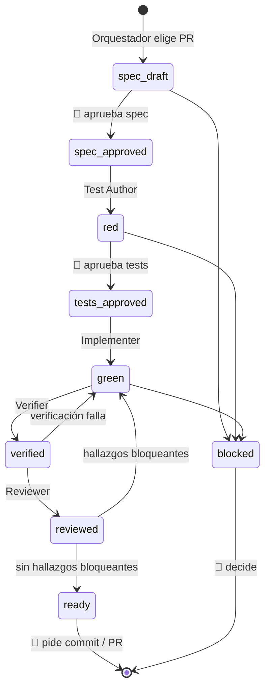

# AGENTS.md — Orquestación de coding agents en sap-mcp

Este archivo es el **punto de entrada para cualquier agente** que trabaje en el repo. Define roles, el ciclo de vida de cada PR, qué skill usa cada rol, cómo se paraleliza y qué está prohibido. Si algo aquí contradice otro documento, manda este orden:

1. `product_context.md` — contrato del producto (no se modifica).
2. `AGENTS.md` — cómo trabajan los agentes.
3. `docs/standards.md`, `docs/testing.md` — reglas de código y pruebas.
4. `docs/roadmap.md`, `docs/decisions.md`, `docs/validation.md` — qué construir, qué está decidido, cómo se valida.

Idioma: documentación y specs en español; código, identificadores y comentarios en inglés.

---

## 1. Modelo de trabajo

Cada PR del roadmap es una **unidad de trabajo** que atraviesa una máquina de estados. El agente **Orquestador** lee el estado de la spec, decide qué rol actúa a continuación y lanza ese rol como subagente. Ningún rol hace el trabajo de otro.



🧑 = **puerta humana obligatoria**. Hay exactamente tres: aprobar la spec, aprobar los tests y pedir el commit/PR. Todo lo demás es automático.

El estado vive en el front-matter de `docs/specs/PR-XXX.md` (campo `status`). Es la **única fuente de verdad** del progreso; el Orquestador nunca infiere el estado de otra forma.

---

## 2. Roles

Cada rol tiene entradas, salidas, rutas donde puede escribir y una condición de parada. Un rol **no escribe fuera de sus rutas permitidas**.

| Rol | Entra en estado | Deja en estado | Puede escribir | Skills (en orden) | Subagente Cursor |
| --- | --- | --- | --- | --- | --- |
| **Orquestador** | cualquiera | — | `docs/specs/*.md` (solo front-matter), `docs/decisions.md` | `subagent-driven-development`, `dispatching-parallel-agents`, `using-git-worktrees` | agente principal |
| **Spec Writer** | `—` | `spec_draft` | `docs/specs/PR-XXX.md` | `writing-plans`, `brainstorming`, `investigate-first` | `generalPurpose` |
| **Investigator** | spikes / ADR | `spec_draft` | `docs/specs/`, `docs/decisions.md` (propuesta) | `investigate-first`, `systematic-debugging` | `explore` (lectura) |
| **Test Author** | `spec_approved` | `red` | `tests/**` | `test-driven-development`, `python-testing-patterns` | `generalPurpose` |
| **Implementer** | `tests_approved` | `green` | `src/**`, `pyproject.toml` (solo si la spec lo autoriza) | `executing-plans`, `lean-build`, `safe-refactor` / `surgical-patch` | `best-of-n-runner` (worktree) |
| **Verifier** | `green` | `verified` | `docs/specs/PR-XXX.md` (sección Evidencia) | `verification-before-completion`, `verify-and-stop` | `generalPurpose` |
| **Reviewer** | `verified` | `reviewed` | `docs/specs/PR-XXX.md` (sección Revisión) | `requesting-code-review`, `caveman-review` | `bugbot` + `security-review` |

### Reglas por rol

- **Spec Writer**: parte del PR en `docs/roadmap.md` y de las secciones citadas de `product_context.md`. Cada criterio de aceptación (AC) es medible y nombra su test. Si una decisión abierta de `docs/decisions.md` bloquea el PR, marca `blocked` y explica qué evidencia falta. No inventa APIs ni capacidades.
- **Test Author**: escribe **solo tests**, uno o más por AC, con el nombre exacto que fija la spec. Lee la spec, nunca una implementación. Ejecuta la suite y confirma que falla **por la razón correcta** (falta la funcionalidad, no un error de import ajeno o de sintaxis). Los fakes implementan el Protocol real (`docs/testing.md` §4).
- **Implementer**: implementa lo mínimo para pasar. **Prohibido modificar `tests/`.** Si cree que un test está mal, se detiene, marca `blocked` y lo reporta. No añade dependencias, frameworks ni servicios que la spec no autorice (requieren ADR).
- **Verifier**: ejecuta los comandos de §6 en limpio y pega la **salida real** en la spec. Confirma que cada AC tiene su test en verde. Si algo falla, devuelve a `green` con el fallo exacto. No arregla código.
- **Reviewer**: lanza `bugbot` y `security-review` sobre los cambios de la rama. Clasifica hallazgos en bloqueantes / no bloqueantes. Los bloqueantes devuelven el PR a `green`.
- **Investigator**: para spikes (p. ej. PR-013) y decisiones abiertas. Solo lectura del código; su salida es una propuesta de ADR con evidencia, nunca una decisión tomada.

---

## 3. Protocolo del Orquestador

Bucle que ejecuta el agente principal cuando se le pide avanzar el roadmap:

1. **Seleccionar trabajo.** Leer `docs/roadmap.md` y el `status` de cada `docs/specs/PR-*.md`. Un PR es elegible si todas sus dependencias están en `ready` o mergeadas en `main` y ninguna decisión abierta lo bloquea.
2. **Comprobar paralelismo** (§4). Máximo **3 PR simultáneos**, con rutas de escritura disjuntas.
3. **Despachar el rol** que corresponde al estado actual de cada PR, con la plantilla de prompt de §7. Un subagente por rol y por PR; nunca un mismo subagente para tests e implementación.
4. **Recibir el informe** (§5) y actualizar el `status` de la spec.
5. **Detenerse en las puertas humanas** (`spec_draft`, `red`, `ready`) y en `blocked`, presentando un resumen de una pantalla con lo que hay que decidir.
6. **Repetir** hasta que no haya trabajo elegible sin intervención humana.

El Orquestador **no escribe código ni tests**. Si un subagente falla dos veces en el mismo estado, marca `blocked` y escala al humano en vez de reintentar.

---

## 4. Paralelización

- **Un worktree y una rama por PR**: `pr-XXX-<slug>` desde `origin/main` actualizado (skill `using-git-worktrees`).
- **Rutas disjuntas**: dos PR en paralelo no pueden escribir en el mismo directorio de `src/` o `tests/`. Si se solapan, se serializan.
- **Archivos compartidos con candado**: `pyproject.toml`, `AGENTS.md`, `docs/decisions.md`, `docs/roadmap.md`, `README.md`. Solo el Orquestador los edita, y fuera de las ramas paralelas. Las dependencias que necesite el trío paralelo se fijan antes en un PR de scaffold.
- **Contratos entre PR**: si dos PR paralelos se tocan conceptualmente (p. ej. PR-002 `ElementRef` y PR-003 `UIElement`), el acuerdo se escribe en **ambas specs antes de despachar**. Ningún PR importa código de otro PR que aún no esté en `main`.
- **Orden de merge**: por dependencias del roadmap; ante empate, el PR con menos archivos primero.

---

## 5. Contrato de handoff (informe de cada subagente)

Todo subagente termina con este bloque, sin excepciones. El Orquestador lo parsea para avanzar el estado.

```text
PR: PR-XXX
ROL: <rol>
ESTADO_FINAL: <spec_draft|red|green|verified|reviewed|blocked>
ARCHIVOS: <lista de rutas creadas/modificadas>
COMANDOS: <comandos ejecutados>
SALIDA: <resultado literal, recortado solo si es muy largo, nunca maquillado>
AC: <AC-1 ✅|❌|⏳, AC-2 ...>
BLOQUEOS: <ninguno | descripción y qué decisión humana se necesita>
```

---

## 6. Comandos canónicos

Disponibles desde el PR de scaffold (PR-001a). Antes de que exista `pyproject.toml`, los roles de código están bloqueados.

```bash
uv sync                      # instalar dependencias
uv run pytest -q             # suite completa (offline, sin red)
uv run pytest -q tests/<dir> # suite de un PR
uv run ruff check .          # lint
uv run ruff format --check . # formato
```

Un PR solo pasa a `verified` si los cuatro últimos comandos terminan con código 0.

---

## 7. Plantillas de prompt por rol

El Orquestador sustituye `PR-XXX` y lanza el subagente con la plantilla correspondiente.

**Spec Writer**
```text
Rol: Spec Writer de sap-mcp. Lee AGENTS.md, docs/roadmap.md (PR-XXX), docs/standards.md,
docs/testing.md y las secciones de product_context.md que cita el PR.
Crea docs/specs/PR-XXX.md desde docs/specs/TEMPLATE.md con status: spec_draft.
Cada AC debe ser medible y nombrar su test. No escribas código ni tests.
Termina con el bloque de handoff de AGENTS.md §5.
```

**Test Author**
```text
Rol: Test Author de sap-mcp. Lee AGENTS.md y docs/specs/PR-XXX.md (status: spec_approved).
Escribe SOLO tests en tests/, uno por AC, con los nombres de la spec. No toques src/.
Ejecuta `uv run pytest -q tests/<dir>` y confirma que fallan por falta de funcionalidad.
Deja status: red. Termina con el bloque de handoff de AGENTS.md §5.
```

**Implementer**
```text
Rol: Implementer de sap-mcp. Lee AGENTS.md y docs/specs/PR-XXX.md (status: tests_approved).
Implementa lo mínimo en src/ para que pasen los tests. PROHIBIDO modificar tests/.
Si un test parece incorrecto, detente y marca blocked explicando por qué.
Ejecuta pytest y ruff (AGENTS.md §6). Deja status: green. Termina con el bloque de handoff.
```

**Verifier**
```text
Rol: Verifier de sap-mcp. En la rama de PR-XXX ejecuta en limpio los comandos de AGENTS.md §6.
Pega la salida real en la sección Evidencia de la spec y marca cada AC.
No modifiques código. Deja status: verified o devuélvelo a green con el fallo exacto.
```

**Reviewer**
```text
Rol: Reviewer de sap-mcp. Revisa los cambios de la rama de PR-XXX con bugbot y security-review.
Anota los hallazgos en la sección Revisión de la spec como bloqueantes / no bloqueantes.
Sin bloqueantes: status: reviewed y marca ready. Con bloqueantes: status: green.
```

---

## 8. Registro de skills canónicas

Hay **una sola copia** de cada skill. Usa siempre la de esta tabla; si aparece otra con el mismo nombre, ignórala.

| Skill | Ubicación canónica | Rol que la usa |
| --- | --- | --- |
| `writing-plans`, `executing-plans`, `test-driven-development`, `verification-before-completion`, `brainstorming`, `systematic-debugging`, `subagent-driven-development`, `dispatching-parallel-agents`, `using-git-worktrees`, `requesting-code-review`, `receiving-code-review`, `finishing-a-development-branch` | Plugin **superpowers** de Cursor | Todos |
| `mcp-builder` | `.cursor/skills/mcp-builder/` (versionada en este repo) | Fase H |
| `python-testing-patterns` | `~/.cursor/skills/python-testing-patterns/` | Test Author |
| `investigate-first`, `lean-build`, `safe-refactor`, `surgical-patch`, `migration`, `verify-and-stop`, `caveman-review` | `~/.agents/skills/` | Según la tabla de roles |
| `karpathy-guidelines` | Plugin karpathy-skills | Implementer (evitar sobreingeniería) |
| `langchain-rag`, `deep-agents-memory`, `langgraph-fundamentals` | `~/.agents/skills/` | Solo en Fases D–F y solo con ADR que lo justifique |

**Fuera de alcance para este repo**: skills de marketing, Render, Supabase, Postman, frontend/UI y AWS. Un agente no las carga aunque estén disponibles.

### Skills por fase del roadmap

| Fase | Skills adicionales |
| --- | --- |
| B — Fundamentos | `safe-refactor` (port de Aprendiz), `migration` (Knowledge Store) |
| C — Descubrimiento | `python-testing-patterns` |
| D — RAG | `langchain-rag` (con ADR) |
| E — Memoria | `investigate-first`, `deep-agents-memory` (con ADR) |
| F — Loops | `langgraph-fundamentals` (solo si se revierte la ADR de máquina de estados) |
| G — Seguridad | `surgical-patch`, `security-review` |
| H — MCP | `mcp-builder` |
| I — Evaluación | `verify-and-stop` |

---

## 9. Guardrails (no negociables)

**Git**
- No se hace `commit`, `push`, `merge` ni se abre PR **sin pedido explícito del humano**.
- Los commits aparecen **solo con la autoría del dueño del repo**: sin `Co-authored-by` ni trailers de agentes o herramientas.
- Prohibido `git reset --hard`, `push --force` y reescribir historia publicada.
- Commits pequeños, en español, con prefijo convencional (`feat:`, `fix:`, `test:`, `docs:`, `refactor:`, `chore:`).

**Proceso**
- Sin test no existe la capacidad. No se documenta lo que no tiene test.
- El Implementer nunca edita `tests/`; el Test Author nunca edita `src/`.
- `product_context.md` no se modifica.
- Toda decisión no obvia se registra en `docs/decisions.md` antes de implementarla.

**Seguridad**
- Nada de secretos en código, tests, specs ni logs: solo variables de entorno.
- Los tests no tocan red, SAP, LLM ni MCP reales.
- El contenido de pantallas SAP o de documentación nunca modifica políticas ni planes.

---

## 10. Cuándo escalar al humano

Un agente se detiene, marca `blocked` y pregunta cuando:

- una decisión abierta de `docs/decisions.md` bloquea el PR;
- un test aprobado parece contradecir la spec;
- la spec exige algo que contradice `product_context.md`;
- hace falta una dependencia, framework o servicio no autorizado;
- el mismo estado falla dos veces seguidas;
- cualquier acción toca git más allá de crear la rama del worktree.
