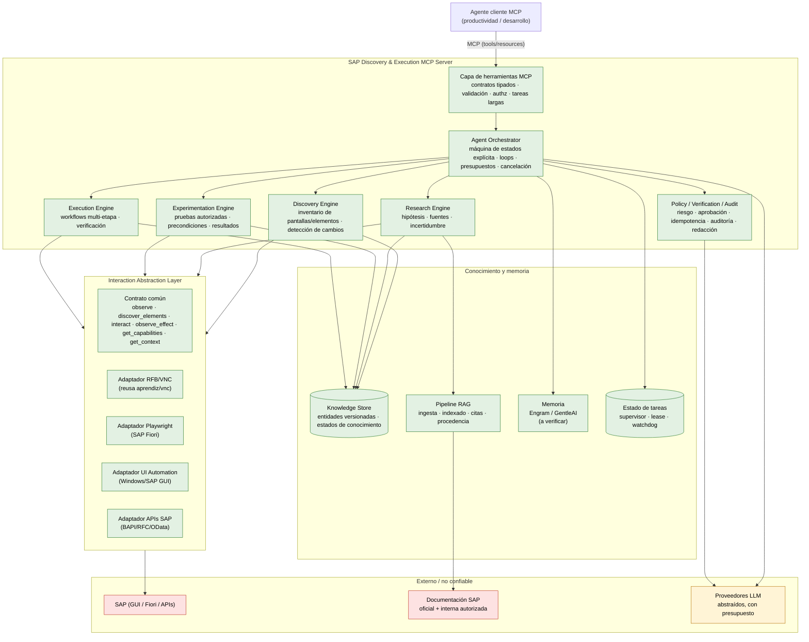

# Arquitectura objetivo — sap-mcp

Deriva de `product_context.md` (§4, §5) y de la auditoría de Aprendiz (`audit-aprendiz.md`). Describe qué construir, cómo se divide y qué decisiones quedan pendientes. **No es un diagrama de implementación final: es el contrato de diseño contra el que se escriben los PR del roadmap.**

## 1. Principios de diseño

1. **Un único servidor MCP como frontera**; la lógica de descubrimiento, aprendizaje, permisos y verificación vive en componentes internos.
2. **Interacción intercambiable**: el núcleo no depende de un protocolo (RFB, Playwright, UIA, API SAP).
3. **Evidencia antes que afirmación**: toda conclusión tiene procedencia; ejecutar ≠ verificar.
4. **Negar por defecto**: la disponibilidad de una herramienta MCP no es autorización universal.
5. **Conocimiento versionado y con contexto**: `Installation` → `Application` → `Screen` → `UIElement`; sin transferencias entre instalaciones.
6. **Complejidad justificada**: sin frameworks, bases de datos ni servicios extra sin evidencia de necesidad.

## 2. Vista de componentes



## 3. Responsabilidades por componente

### 3.1 Capa de herramientas MCP
- Expone herramientas **orientadas a capacidades**, no un tool por botón SAP (las candidatas están en `product_context.md` §10).
- Contratos tipados, validación de argumentos, errores explícitos y consistentes.
- Autenticación y autorización del lado del servidor.
- Operaciones de larga duración: `task_id` + polling, sin ejecuciones duplicadas.
- Cada ejecución con identificador y traza.

### 3.2 Agent Orchestrator
- Máquina de estados explícita (no un framework salvo justificación; ver `decisions.md`).
- Decide si una tarea requiere descubrir, investigar, experimentar o ejecutar.
- Presupuestos, límites de pasos, timeouts, cancelación, pausas/aprobaciones.
- Lock por sesión SAP (una operación incompatible a la vez).
- Reutiliza del supervisor de Aprendiz: lock, watchdog, lease, cierre ordenado.

### 3.3 Interaction Abstraction Layer
Contrato común (nombres de diseño, a concretar en PR-002):

| Capacidad | Descripción |
| --- | --- |
| `observe` | Obtener el estado actual (captura/snapshot semántico). |
| `discover_elements` | Identificar elementos y propiedades disponibles. |
| `interact` | Ejecutar una interacción sobre un objetivo. |
| `observe_effect` | Detectar cambios posteriores a una acción. |
| `get_capabilities` | Declarar qué puede hacer el adaptador. |
| `get_context` | Sesión, aplicación, entorno disponible. |

Regla: **no simular información semántica cuando solo hay píxeles.** El adaptador declara capacidades reales.

- **RFB/VNC (primero, reutiliza `aprendiz/vnc`):** percepción visual + eventos de teclado/ratón. Limitación reconocida: píxeles sin semántica.
- **Playwright (segundo):** SAP Fiori; selectores y condiciones de espera semánticas.
- **UI Automation (tercero, evaluar):** SAP GUI en Windows con árboles accesibles.
- **APIs SAP (complemento):** BAPI/RFC/OData cuando existan y haya permisos; nunca suplanta la automatización visual cuando la API no cubre el caso.

### 3.4 Discovery Engine
- Inventario de pantallas, elementos, menús, campos, tablas, diálogos, mensajes, estados de carga.
- Relaciones de navegación (`NavigationEdge`).
- Distingue observado directo / semántico / inferido por modelo.
- Detección de elementos nuevos o desaparecidos → marca `stale`.
- No depende de coordenadas fijas; las coordenadas se verifican antes de interactuar.

### 3.5 Research Engine
- Recupera conocimiento existente y documentación.
- Genera hipótesis, compara con lo observado, registra procedencia y confianza.
- **Las hipótesis no se convierten automáticamente en conocimiento validado.**

### 3.6 Experimentation Engine
- Separa acciones: observación / navegación / preparación / escritura / compromiso / irreversible.
- Define precondiciones, límites, observaciones esperadas y verificación antes de cada prueba.
- Solo pruebas autorizadas; nunca duplicar registros ni activar procesos reales.

### 3.7 Execution Engine
- Consume procedimientos validados, verifica estado actual y precondiciones antes de actuar.
- No trata la memoria como autorización; un procedimiento exitoso no sigue siendo válido sin revalidar.

### 3.8 Policy / Verification / Audit
- Autorización del lado del servidor; políticas por usuario/sesión/operación.
- Evaluación de riesgo; aprobaciones humanas.
- Protección contra duplicados y reintentos inseguros (reconciliación tras timeout).
- Verificación de efectos con señal independiente.
- Auditoría completa; redacción de datos sensibles; **el contenido de SAP y de la documentación es dato no confiable y no modifica políticas.**

## 4. Modelo de conocimiento (versión inicial)

Entidades candidatas (a ajustar en PR-003 tras el spike):

`Installation`, `Application`, `Module`, `SessionContext`, `Screen`, `UIElement`, `NavigationEdge`, `BusinessConcept`, `Procedure`, `Workflow`, `Action`, `Evidence`, `Hypothesis`, `ValidationRun`, `ExecutionRun`, `KnowledgeRevision`.

Estados de conocimiento (`product_context.md` §8.3):

```
discovered → documented → experimentally_observed → validated
                ↘ conflicted
                ↘ stale → deprecated
```

Las transiciones dependen de **reglas y evidencia**, no de la confianza declarada por un modelo.

## 5. Loops especializados

Cuatro loops compartiendo contexto, herramientas, memoria y estado, con límites comunes (presupuesto, pasos, timeout, cancelación, detección de ciclos, tratamiento de ambiguos):

1. **Discovery Loop** — observar → identificar → comparar → registrar → seleccionar siguiente.
2. **Research Loop** — seleccionar desconocido → consultar memoria/KS → RAG → hipótesis → contrastar → registrar procedencia.
3. **Experimentation Loop** — hipótesis → riesgo → autorización → preparar → ejecutar → observar → comparar → guardar evidencia → actualizar.
4. **Execution Loop** — intención → procedimiento → estado actual → precondiciones → plan → permisos → ejecutar etapa → verificar → continuar/detener → estado final.

## 6. Reutilización concreta desde Aprendiz

| Bloque nuevo de sap-mcp | Se apoya en (Aprendiz) |
| --- | --- |
| Adaptador RFB | `src/aprendiz/vnc/` (client, lease, keys, errors) |
| Orquestador | `tasks.py` (lock/watchdog/deadline), `store.py` (estado de tareas) |
| Cliente LLM | `agent/llm.py` + `agent/budget.py` (abstraer proveedor) |
| Schemas cerrados | `agent/schemas.py` + `agent/structured.py` |
| Policy/Verification | `agent/gate.py`, `agent/classifier.py`, `agent/detector.py`, `agent/verifier.py` (extender a clases de riesgo) |
| Resumen/redacción | `agent/summary.py` + `redact.py` |
| Trazas | `agent/trace.py` |
| Evaluación | `eval/harness.py`, `eval/scoring.py`, `eval/schema.py` |

## 7. Decisiones técnicas pendientes

Ver `decisions.md` para el estado y dueño de cada una:

1. **Stack del MCP server**: Python (FastMCP/SDK oficial) para reutilizar el núcleo Python, vs. TypeScript (recomendado por el skill `mcp-builder`) como frontera delgada ante un núcleo Python. *Recomendación preliminar:* Python FastMCP en el MVP para no introducir un segundo servicio; reevaluar TS solo si el cliente lo exige.
2. **Orquestador**: máquina de estados explícita (reusa Aprendiz) vs. LangGraph. *Recomendación:* máquina de estados explícita; LangGraph solo si aparece una necesidad real de grafos.
3. **Knowledge Store**: SQLite (MVP, un solo proceso) vs. Postgres. *Recomendación:* SQLite con capa de repositorio para migrar sin dolor.
4. **RAG**: búsqueda textual + vectorial híbrida; store a elegir tras medir volumen (SQLite FTS5 + embeddings vs. vector store dedicado).
5. **Engram y GentleAI**: verificar repos, interfaces, persistencia, licencias y solapamientos antes de integrar (Fase E).
6. **Proveedor LLM**: abstraer `Llm` para múltiples proveedores y precios dinámicos.
7. **Playwright/UIA/APIs SAP**: orden de incorporación y entorno de pruebas SAP real (sandbox vs. cliente).

## 8. Límites de confianza

| Límite | Qué cruza | Regla |
| --- | --- | --- |
| Cliente MCP → server | Llamadas a tools | Autenticación + autorización por operación; la disponibilidad del tool no autoriza. |
| Server → proveedores LLM | Texto, capturas, recortes, plan | Sin secretos; capturas pueden contener datos sensibles (redacción en trazas). |
| Server ↔ SAP | Entradas + framebuffer/semántica | Contenido no confiable; no modifica políticas ni concede permisos. |
| RAG → Research | Fragmentos + citas | Procedencia obligatoria; fuente interna ≠ fuente oficial SAP. |
| Memoria → Execution | Procedimientos previos | Nunca es autorización; revalidar antes de ejecutar. |

## 9. Trazabilidad con el roadmap

- PR-002 materializa el contrato de la capa de interacción (§3.3).
- PR-003 materializa el modelo de conocimiento (§4).
- PR-004..006 materializan la reutilización (§6).
- PR-007..009 → Discovery Engine (§3.4, loop 1).
- PR-010..012 → Research + RAG (§3.5, loop 2).
- PR-013..014 → Memoria (§6, Fase E).
- PR-015..017 → Experimentation + Execution + Orquestador (§3.6, §3.7, §3.2, loops 3-4).
- PR-018..020 → Policy/Verification/Audit (§3.8).
- PR-021..023 → MCP (§3.1).
- PR-024..025 → Ejecución y evaluación (§12 del product_context).
