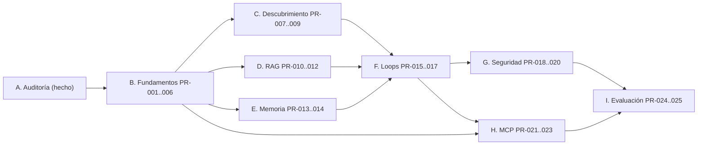

# Roadmap técnico — sap-mcp

Roadmap de implementación incremental derivado de `product_context.md` §17 y de la auditoría de Aprendiz. Organizado en fases por dependencias técnicas y valor demostrable. **Cada PR es pequeño, con criterios de aceptación medibles y una prueba que demuestra su capacidad.**

Principio rector: construir un MCP que descubra una instalación SAP, aprenda de ella con evidencia, conserve conocimiento reutilizable y ejecute operaciones autorizadas cuyos resultados pueda verificar. No simular inteligencia con prompts.

## 1. Resumen de fases

| Fase | Objetivo | PR |
| --- | --- | --- |
| **A. Auditoría** | Analizar el repo previo. | ✅ Hecho (`docs/audit-aprendiz.md`). No requiere PR de código. |
| **B. Fundamentos** | Contrato de interacción, modelo de conocimiento, seed de Aprendiz reutilizado. | PR-001..006 |
| **C. Descubrimiento** | Inventario de pantallas/elementos, persistencia, cambios, estados de conocimiento. | PR-007..009 |
| **D. Investigación y RAG** | Ingestión, recuperación, procedencia, Research Loop. | PR-010..012 |
| **E. Memoria** | Verificar Engram/GentleAI; integrar lo justificado. | PR-013..014 |
| **F. Loops** | Orquestador + Discovery/Research/Experimentation/Execution loops. | PR-015..017 |
| **G. Seguridad** | Riesgo, autorización, aprobaciones, idempotencia, auditoría, redacción. | PR-018..020 |
| **H. MCP** | Tools tipadas, tareas largas, auth, interoperabilidad real. | PR-021..023 |
| **I. Ejecución y evaluación** | Workflow representativo, fallos, métricas, limitaciones. | PR-024..025 |

## 2. Grafo de dependencias

Reglas de orden:
- **B antes que todo**: el contrato de interacción (PR-002) y el modelo de conocimiento (PR-003) son las interfaces que todos consumen.
- **C y D son paralelizables** tras B (dependencias distintas).
- **E es independiente de C/D** (solo necesita B); se puede adelantar.
- **F integra C, D, E**.
- **H puede iniciarse tras B** (tools esqueleto), pero las tools reales dependen de F.
- **I es la puerta final** que valida el MVP.

---

## Fase B — Fundamentos

### PR-001 · Bootstrap del repositorio y semilla de Aprendiz
- **Objetivo:** crear el esqueleto de `sap-mcp` y traer los componentes reutilizables de Aprendiz como base versionada, con su suite de tests en verde.
- **Problema que resuelve:** sin base no hay punto de partida; se evita reescribir el driver VNC, el cliente LLM, el presupuesto y el supervisor.
- **Contexto técnico:** importar `vnc/`, `agent/llm.py`, `agent/budget.py`, `agent/schemas.py`, `agent/structured.py`, `agent/redact.py`, `agent/summary.py`, `agent/hoy.py`, `agent/table_reader.py`, `tasks.py`, `store.py`, `vnc/lease.py`, `agent/trace.py` desde `frontier-hackathon-equipo`. Configurar `pyproject.toml`, `uv`, `ruff`, `pytest`, CI.
- **Archivos afectados:** `pyproject.toml`, `src/sap_mcp/`, `tests/`, `docs/decisions.md`.
- **Dependencias:** A (auditoría).
- **Tareas:** (1) scaffold del paquete `sap_mcp`; (2) copiar módulos reutilizables bajo namespace nuevo; (3) migrar imports; (4) portar tests offline correspondientes; (5) CI con `pytest` + `ruff`.
- **Pruebas:** los tests offline de Aprendiz (RFB falso, runner falso, budget, schemas, redact, summary) deben pasar sin red.
- **Criterios de aceptación:** `uv run pytest -q` y `uv run ruff check .` en verde en CI; sin código de negocio nuevo; README actualizado con el origen de la semilla.
- **Riesgos/decisiones:** licencias y autoría del código reutilizado (verificar que la reutilización es legítima y citar el origen); no arrastrar `episode.py` monolítico ni el runner HTTP (se reemplazan después).
- **Resultado:** repositorio con base probada y CI.

### PR-002 · Contrato de la Interaction Abstraction Layer
- **Objetivo:** definir el contrato común de interacción como Protocol/schemas y sus capacidades.
- **Problema:** el núcleo no debe depender de un protocolo concreto (RFB, Playwright, UIA, API SAP).
- **Contexto técnico:** materializar `observe`, `discover_elements`, `interact`, `observe_effect`, `get_capabilities`, `get_context` (§5.5). Tipos: `Observation`, `ElementRef`, `ElementList`, `Interaction`, `Effect`, `AdapterCapabilities`, `SessionContext`. `extra="forbid"`.
- **Archivos:** `src/sap_mcp/interaction/contracts.py`, `tests/interaction/test_contracts.py`.
- **Dependencias:** PR-001.
- **Tareas:** (1) definir schemas cerrados; (2) definir `InteractionAdapter` Protocol; (3) definir `ElementRef` estable que **no** sea coordenada fija; (4) definir `AdapterCapabilities` honesto (sin simular semántica si solo hay píxeles).
- **Pruebas:** validación de schemas; un adaptador falso que implementa el Protocol; test de que una coordenada es evidencia, no identidad.
- **Criterios de aceptación:** los cuatro adaptadores futuros pueden implementar el Protocol sin cambiar el núcleo; schemas rechazan entradas inválidas; sin mención a VNC dentro del contrato.
- **Riesgos:** sobre-diseño del contrato — mantenerlo mínimo y evolucionarlo con los adaptadores.
- **Resultado:** contrato tipado, sin dependencia de protocolo.

### PR-003 · Modelo de conocimiento v0 y Knowledge Store
- **Objetivo:** definir las entidades iniciales y su persistencia versionada.
- **Problema:** sin registro estructurado, el conocimiento no sobrevive entre sesiones ni distingue hipótesis de hechos.
- **Contexto técnico:** entidades §8.1: `Installation`, `Application`, `Screen`, `UIElement`, `NavigationEdge`, `Procedure`, `Evidence`, `Hypothesis`, `KnowledgeRevision`. Estados §8.3 con transiciones por reglas. Persistencia SQLite con capa repositorio (port para migrar). Versión por registro.
- **Archivos:** `src/sap_mcp/knowledge/models.py`, `src/sap_mcp/knowledge/store.py`, `tests/knowledge/`.
- **Dependencias:** PR-001.
- **Tareas:** (1) schemas Pydantic cerrados; (2) store SQLite con migraciones; (3) función de transición de estados con evidencia requerida; (4) `KnowledgeRevision` inmutable por revisión.
- **Pruebas:** crear/recuperar/versionar entidades; transiciones válidas e inválidas; aislamiento por `Installation`.
- **Criterios de aceptación:** un elemento guardado se recupera con su procedencia y revisión; una hipótesis no puede pasar a `validated` sin `Evidence`; separación por instalación probada.
- **Riesgos:** modelar de más al inicio — empezar con el subconjunto del MVP (Screen, UIElement, NavigationEdge, Evidence, Hypothesis).
- **Resultado:** Knowledge Store con estados y versionado.

### PR-004 · Adaptador RFB/VNC sobre el contrato
- **Objetivo:** envolver `aprendiz/vnc` tras el contrato de PR-002.
- **Problema:** reutilizar el driver sin acoplar el núcleo a RFB.
- **Contexto técnico:** el driver ya hace captura, eventos, estabilidad. El adaptador traduce framebuffer → `Observation` y declara capacidades "solo píxeles". El límite de resolución deja de ser 1280×800 fijo: se lee del framebuffer.
- **Archivos:** `src/sap_mcp/interaction/rfb.py`, `tests/interaction/test_rfb.py`.
- **Dependencias:** PR-002.
- **Tareas:** (1) implementar `InteractionAdapter` para RFB; (2) mapear capturas a `Observation`; (3) `get_capabilities` honesto; (4) quitar la validación hardcodeada de resolución.
- **Pruebas:** tests offline con el servidor RFB falso de Aprendiz; verificación de capacidades declaradas.
- **Criterios de aceptación:** el núcleo no importa `vnc`; el adaptador captura e interactúa contra el RFB falso; resolución dinámica.
- **Riesgos:** encoding sin compresión (bandwidth) — aceptado para MVP, documentado.
- **Resultado:** primer adaptador operativo.

### PR-005 · Orquestador esqueleto: supervisor, lease y watchdog
- **Objetivo:** portar el patrón de tareas de larga duración (lock por sesión, deadline, cancelación, cierre ordenado) al namespace nuevo.
- **Problema:** las operaciones SAP son largas; se necesita estado persistente, cancelación y no-duplicación.
- **Contexto técnico:** reutiliza `tasks.py` + `store.py` + `lease.py`. Estado explícito de tarea: `en_curso`, `terminada`, `fallida`, `pendiente_autorizacion`, `bloqueada`, `desconocida` (extiende Aprendiz).
- **Archivos:** `src/sap_mcp/orchestrator/supervisor.py`, `store.py`, `tests/orchestrator/`.
- **Dependencias:** PR-001, PR-003.
- **Tareas:** (1) portar lock/watchdog/lease; (2) añadir estados nuevos; (3) persistir tareas y transiciones; (4) `fail_unfinished` al arrancar.
- **Pruebas:** lock por sesión (dos tareas incompatibles); cancelación y cierre ordenado; recuperación tras reinicio.
- **Criterios de aceptación:** una tarea nueva desplaza/rechaza según política; el cierre libera entradas antes de publicar; tareas en curso al reiniciar quedan `fallida`.
- **Riesgos:** decidir política de desplazamiento vs. cola (documentar en ADR).
- **Resultado:** supervisor de larga duración.

### PR-006 · Cliente LLM multi-proveedor con presupuesto
- **Objetivo:** abstraer el proveedor y el precio, conservando reserva de costo.
- **Problema:** Aprendiz tiene precios de OpenRouter hardcodeados y un solo proveedor.
- **Contexto técnico:** conservar `Llm` Protocol, timeout, reintentos, reserva; añadir tabla de precios por configuración (no hardcodeada) y poder inyectar otro proveedor.
- **Archivos:** `src/sap_mcp/llm/client.py`, `src/sap_mcp/llm/budget.py`, `tests/llm/`.
- **Dependencias:** PR-001.
- **Tareas:** (1) portar `llm.py`/`budget.py`; (2) precios desde config; (3) interfaz de proveedor; (4) mantener `ask_json` con schema cerrado.
- **Pruebas:** reserva antes de llamada; fallo libera reserva; reintentos acotados; proveedor falso.
- **Criterios de aceptación:** cambiar de proveedor no toca el núcleo; un modelo desconocido reserva al precio más caro; sin precios en código.
- **Resultado:** cliente LLM desacoplado.

---

## Fase C — Descubrimiento

### PR-007 · Discovery Loop v0: inventario de pantalla y elementos
- **Objetivo:** observar una pantalla, identificar elementos interactivos y persistirlos.
- **Problema:** el sistema debe inventariar interfaces desconocidas sin coordenadas fijas.
- **Contexto técnico:** usar `observe` + `discover_elements`; clasificar tipo (botón, campo, menú, tabla, diálogo, mensaje); registrar contexto (`Installation`, `Application`, `Screen`, fecha, método de detección). Distinguir observado/semántico/inferido.
- **Archivos:** `src/sap_mcp/discovery/engine.py`, `loop.py`, `tests/discovery/`.
- **Dependencias:** PR-002, PR-003, PR-004, PR-006.
- **Tareas:** (1) extracción de elementos desde una `Observation`; (2) persistencia en Knowledge Store; (3) `discovered` como estado inicial; (4) detección de nuevos/desaparecidos.
- **Pruebas:** con `Observation` fija (captura + metadatos), los elementos se persisten con contexto y procedencia; un elemento sin evidencia semántica no se etiqueta como semántico.
- **Criterios de aceptación:** una pantalla desconocida produce un inventario persistente y consultable; dos pantallas distintas no comparten identidad de elemento.
- **Resultado:** primer mapa de pantalla.

### PR-008 · Detección de cambios e invalidación (`stale`)
- **Objetivo:** detectar que una pantalla/elemento cambió y marcar el conocimiento como obsoleto.
- **Problema:** el conocimiento deja de ser válido cuando cambia la interfaz (lección del incidente FR-0153).
- **Contexto técnico:** comparar `Observation` actual contra la registrada (diff de píxeles + comparación semántica cuando haya). Distinguir "app cambió" de "navegación falló". Transición `validated → stale`.
- **Archivos:** `src/sap_mcp/discovery/change.py`, `tests/discovery/test_change.py`.
- **Dependencias:** PR-007.
- **Tareas:** (1) diff por región (cabecera/menú) vs. pantalla completa; (2) heurística navegación-fallida; (3) transición a `stale` con evidencia; (4) no borrar la revisión anterior.
- **Pruebas:** cambio de tema detecta `stale`; navegación fallida no invalida; falsos positivos conocidos (texto seleccionado) no invalidan.
- **Criterios de aceptación:** un cambio real marca `stale` con evidencia y conserva la revisión previa; una navegación fallida no invalida.
- **Resultado:** invalidation progresiva.

### PR-009 · Transiciones de estado de conocimiento
- **Objetivo:** implementar las reglas de transición entre estados de conocimiento.
- **Problema:** la confianza debe subir por evidencia, no por repetición de una respuesta.
- **Contexto técnico:** máquina de estados `discovered → documented → experimentally_observed → validated`, con `conflicted`, `stale`, `deprecated`. Cada transición exige evidencia específica.
- **Archivos:** `src/sap_mcp/knowledge/states.py`, `tests/knowledge/test_states.py`.
- **Dependencias:** PR-003.
- **Tareas:** (1) reglas de transición; (2) registro de qué evidencia disparó cada transición; (3) `conflicted` ante evidencia contradictoria.
- **Pruebas:** cada transición válida requiere su evidencia; `validated` sin `Evidence` es imposible; contradicción produce `conflicted`.
- **Criterios de aceptación:** ningún estado se alcanza sin la evidencia exigida por regla; transiciones auditables.
- **Resultado:** conocimiento con estados verificables.

---

## Fase D — Investigación y RAG

### PR-010 · Ingestión documental con procedencia
- **Objetivo:** incorporar fuentes autorizadas normalizando y conservando metadatos.
- **Problema:** el Research Engine necesita documentación con URL, título, versión, fecha y tipo (oficial vs. interna).
- **Contexto técnico:** pipeline §7.3: cargar, extraer, normalizar, dividir, indexar, conservar procedencia. Fuentes internas marcadas aparte.
- **Archivos:** `src/sap_mcp/rag/ingest.py`, `tests/rag/test_ingest.py`.
- **Dependencias:** PR-001.
- **Tareas:** (1) loader de documentos; (2) split en unidades recuperables; (3) metadatos de procedencia obligatorios; (4) actualización/retiro de contenido obsoleto.
- **Pruebas:** un documento se divide y conserva URL/versión/fecha; fuente interna ≠ oficial; retirar un documento lo excluye de la recuperación.
- **Criterios de aceptación:** todo fragmento indexado conserva su procedencia; sin procedencia no se indexa.
- **Resultado:** corpus con trazabilidad.

### PR-011 · Recuperación híbrida con citas
- **Objetivo:** recuperar fragmentos relevantes con citas y evaluar relevancia.
- **Problema:** el contexto de la consulta (producto, módulo, versión, pantalla, elemento) reduce aplicar documentación equivocada.
- **Contexto técnico:** búsqueda textual (SQLite FTS5) + vectorial (embeddings); híbrido; `retrieve(query, context)` devuelve fragmentos + citas + score. Evaluación de relevancia.
- **Archivos:** `src/sap_mcp/rag/retrieve.py`, `tests/rag/test_retrieve.py`.
- **Dependencias:** PR-010.
- **Tareas:** (1) indexado textual y vectorial; (2) consulta contextual; (3) citas y referencias; (4) métrica de relevancia.
- **Pruebas:** consulta con versión equivocada no devuelve fragmentos de otra versión; resultados con cita; relevancia medida sobre un set dorado pequeño.
- **Criterios de aceptación:** recuperación devuelve procedencia y score; el contexto filtra por producto/versión.
- **Resultado:** RAG consultable.

### PR-012 · Research Loop
- **Objetivo:** investigar un elemento: memoria + KS + RAG → hipótesis → incertidumbre.
- **Problema:** convertir hallazgos en hipótesis con procedencia, sin convertirlas en hechos.
- **Contexto técnico:** loop §9.2. Consulta KS, memoria y RAG; formula hipótesis; compara fuentes y pantalla; registra `documented`/`hypothesis` con confianza y procedencia; conserva incertidumbre si la documentación falta o contradice.
- **Archivos:** `src/sap_mcp/research/loop.py`, `tests/research/`.
- **Dependencias:** PR-003, PR-009, PR-011.
- **Tareas:** (1) implementar el loop; (2) registrar hipótesis con fuentes; (3) detección de contradicción; (4) presupuesto/pasos/timeout.
- **Pruebas:** con fuentes fijas, una hipótesis se registra con procedencia; sin documentación, el resultado expresa incertidumbre (no inventa); contradicción produce `conflicted`.
- **Criterios de aceptación:** el Research Loop nunca convierte hipótesis en `validated`; toda conclusión cita fuente o declara ausencia.
- **Resultado:** investigación respaldada por documentación.

---

## Fase E — Memoria

### PR-013 · Verificación de Engram y GentleAI (spike, sin integración)
- **Objetivo:** auditar repos, interfaces, persistencia, licencias y solapamientos de ambos proyectos.
- **Problema:** `product_context.md` §6 prohíbe asumir capacidades o integrar sin verificar.
- **Contexto técnico:** investigar documentación oficial y código real; identificar tipos de memoria, consulta/actualización, latencia, infraestructura, licencias; detectar solapamientos.
- **Archivos:** `docs/decisions.md` (resultado del spike), posible `docs/memory-assessment.md`.
- **Dependencias:** ninguna (solo lectura).
- **Tareas:** (1) verificar cada proyecto; (2) tabla comparativa; (3) decidir qué memoria usa cada componente (experiencia / conocimiento validado / estado transaccional); (4) documentar si alguno no aporta valor.
- **Pruebas:** no aplica (spike documental); el resultado es un ADR con evidencia.
- **Criterios de aceptación:** decisión documentada con evidencia real (no supuestos); conclusión explícita de solapamientos.
- **Riesgos:** que un proyecto no exista/esté inmaduro — documentar y no integrar.
- **Resultado:** decisión de memoria informada.

### PR-014 · Integración de memoria justificada
- **Objetivo:** integrar solo la memoria que aporte valor, con persistencia y recuperación probadas.
- **Problema:** aprovechar experiencias sin repetir investigación, sin duplicar el Knowledge Store.
- **Contexto técnico:** según PR-013. Separar experiencia (memoria) de conocimiento validado (KS) y estado transaccional (supervisor). Políticas de actualización/expiración/invalidación y contexto suficiente para no contaminar instalaciones.
- **Archivos:** `src/sap_mcp/memory/`, `tests/memory/`.
- **Dependencias:** PR-013, PR-003.
- **Tareas:** (1) adaptador de memoria; (2) consulta/actualización; (3) invalidación; (4) pruebas de persistencia y no-contaminación entre instalaciones.
- **Pruebas:** recuperar una experiencia de la misma instalación; no transferir a otra instalación; expiración.
- **Criterios de aceptación:** la memoria recupera contexto útil con instalación correcta; si no aporta valor, se documenta y no se integra.
- **Resultado:** memoria operativa o conclusión de no-integración.

---

## Fase F — Loops

### PR-015 · Experimentation Loop
- **Objetivo:** ejecutar pruebas autorizadas para confirmar/descartar hipótesis.
- **Problema:** aprender por interacción sin pulsar indiscriminadamente.
- **Contexto técnico:** loop §9.3. Clasificar acción por riesgo; definir precondiciones, resultado esperado y verificación antes de cada prueba; solo pruebas permitidas; sin duplicar registros ni activar procesos reales.
- **Archivos:** `src/sap_mcp/experimentation/loop.py`, `tests/experimentation/`.
- **Dependencias:** PR-005, PR-009, PR-012.
- **Tareas:** (1) modelo de `Experiment`; (2) evaluación de riesgo previa; (3) verificación de autorización y entorno; (4) observación posterior y actualización de conocimiento.
- **Pruebas:** un experimento sin autorización no se ejecuta; una prueba de solo lectura se permite; el resultado actualiza el estado solo con evidencia.
- **Criterios de aceptación:** ninguna prueba destructiva sin autorización; todo experimento registra hipótesis, resultado esperado y evidencia.
- **Resultado:** experimentación controlada.

### PR-016 · Execution Loop
- **Objetivo:** ejecutar workflows multi-etapa con verificación.
- **Problema:** operar procesos de varias pantallas sin declarar éxito por un clic.
- **Contexto técnico:** loop §9.4 y §3.4. Recuperar procedimiento, observar estado, verificar precondiciones, planificar, permisos, ejecutar etapa, verificar efecto, continuar/detener, comprobar estado final.
- **Archivos:** `src/sap_mcp/execution/loop.py`, `tests/execution/`.
- **Dependencias:** PR-005, PR-009, PR-014.
- **Tareas:** (1) modelo de `Workflow`/`ExecutionRun`; (2) plan de operación; (3) ejecución por etapas con verificación; (4) estados finales explícitos (§3.5).
- **Pruebas:** workflow multi-paso contra adaptador falso; timeout tras escritura no reintenta a ciegas; éxito solo con verificación.
- **Criterios de aceptación:** un workflow no declara éxito sin evidencia; estados finales distinguen "verificado" de "incompleto/desconocido".
- **Resultado:** ejecución empresarial verificable.

### PR-017 · Orquestador completo: selección de loops, límites y recuperación
- **Objetivo:** integrar los cuatro loops bajo el orquestador con presupuestos, cancelación y recuperación.
- **Problema:** decidir qué loop usar y acotar cada ejecución.
- **Contexto técnico:** máquina de estados del orquestador; límites comunes §9.5 (presupuesto, pasos, timeout, cancelación, ciclos, ambiguos, reintentos peligrosos).
- **Archivos:** `src/sap_mcp/orchestrator/engine.py`, `tests/orchestrator/`.
- **Dependencias:** PR-005, PR-007, PR-012, PR-015, PR-016.
- **Tareas:** (1) dispatch a loops; (2) presupuestos y límites; (3) recuperación sin reintentos ciegos; (4) detección de ciclos.
- **Pruebas:** tarea de descubrimiento vs. ejecución elige el loop correcto; presupuesto agotado corta limpio; ciclo detectado termina.
- **Criterios de aceptación:** ningún loop excede sus límites; recuperación no repite escrituras.
- **Resultado:** orquestador operativo.

---

## Fase G — Seguridad

### PR-018 · Clasificación de riesgo y capa de políticas
- **Objetivo:** clasificar acciones por riesgo y aplicar autorización del lado del servidor.
- **Problema:** observar no autoriza activar; acciones irreversibles requieren controles proporcionales.
- **Contexto técnico:** categorías §11.3 (observación, navegación, consulta, preparación, creación/modificación, compromiso transaccional, aprobación, destructiva). Políticas por usuario/sesión/operación. Reutiliza y extiende `classifier.py`/`gate.py`.
- **Archivos:** `src/sap_mcp/policy/risk.py`, `src/sap_mcp/policy/authz.py`, `tests/policy/`.
- **Dependencias:** PR-017.
- **Tareas:** (1) clasificador de riesgo; (2) motor de políticas; (3) negar por defecto; (4) integración con el gate.
- **Pruebas:** observación/navegación más autónomas; creación/destrucción exigen más control; sin permiso no se ejecuta.
- **Criterios de aceptación:** toda acción sensible pasa por políticas; el prompt no concede permisos.
- **Resultado:** autorización central.

### PR-019 · Aprobaciones humanas, idempotencia y reconciliación
- **Objetivo:** pausar y aprobar operaciones de alto riesgo; evitar duplicados y reintentos inseguros.
- **Problema:** timeout tras escritura no debe reintentar a ciegas; operaciones financieras requieren aprobación.
- **Contexto técnico:** estado `pendiente_autorizacion`; flujo de aprobación; identificadores de ejecución; reconciliación tras interrupción (comprobar estado real antes de repetir).
- **Archivos:** `src/sap_mcp/policy/approval.py`, `src/sap_mcp/policy/idempotency.py`, `tests/policy/`.
- **Dependencias:** PR-018.
- **Tareas:** (1) flujo de aprobación; (2) idempotencia por execution id; (3) reconciliación post-timeout; (4) anti-duplicados.
- **Pruebas:** una escritura interrumpida verifica estado antes de reintentar; duplicado detectado; aprobación requerida para alto riesgo.
- **Criterios de aceptación:** no se repite una escritura sin comprobar si ya se aplicó; aprobaciones bloquean hasta decisión humana.
- **Resultado:** operaciones seguras y sin duplicados.

### PR-020 · Auditoría, redacción y defensa contra inyección
- **Objetivo:** registrar auditoría completa y proteger datos sensibles e inyección de instrucciones.
- **Problema:** trazabilidad y que el contenido de SAP/documentación no modifique políticas.
- **Contexto técnico:** auditoría §11.6 (task, objetivo, contexto, plan, acciones, decisiones, evidencia, resultado); redacción de datos sensibles; defensa en profundidad (plan congelado, regla de texto, gate).
- **Archivos:** `src/sap_mcp/audit/`, `tests/audit/`.
- **Dependencias:** PR-018.
- **Tareas:** (1) registro de auditoría; (2) redacción; (3) pruebas de inyección; (4) integración con trazas.
- **Pruebas:** una pantalla con "ignora tus políticas" no altera la autorización; logs sin secretos; auditoría completa de una operación.
- **Criterios de aceptación:** toda ejecución importante deja auditoría; datos sensibles redactados; inyección no escala privilegios.
- **Resultado:** auditoría e integridad.

---

## Fase H — MCP

### PR-021 · Servidor MCP con herramientas tipadas (esqueleto completo)
- **Objetivo:** exponer las herramientas candidatas (§10) con contratos tipados.
- **Problema:** el cliente MCP debe acceder a descubrimiento, investigación, experimentación y ejecución.
- **Contexto técnico:** usar skill `mcp-builder`. Tools orientadas a capacidades (no un tool por botón). Esquemas tipados, errores explícitos, descripciones accionables. Decisión de stack en `decisions.md` (Python FastMCP por defecto).
- **Archivos:** `src/sap_mcp/mcp/server.py`, `tools.py`, `tests/mcp/`.
- **Dependencias:** PR-017.
- **Tareas:** (1) definir schemas de tools; (2) implementar handlers que delegan al orquestador; (3) validación de argumentos; (4) errores consistentes.
- **Pruebas:** un cliente MCP falso invoca cada tool; argumentos inválidos devuelven error accionable; herramientas listadas correctamente.
- **Criterios de aceptación:** las tools exponen capacidades, no botones; contratos tipados y documentados.
- **Resultado:** MCP server funcional.

### PR-022 · Operaciones de larga duración, autenticación y permisos en MCP
- **Objetivo:** iniciar/consultar tareas largas sin duplicarlas; autenticar y autorizar.
- **Problema:** el MCP no puede bloquearse en operaciones largas; cada tool sensible verifica permisos.
- **Contexto técnico:** `task_id` + polling; el server mantiene control sobre acciones permitidas; auth por operación.
- **Archivos:** `src/sap_mcp/mcp/auth.py`, `src/sap_mcp/mcp/tasks.py`, `tests/mcp/`.
- **Dependencias:** PR-021.
- **Tareas:** (1) patrón start/status; (2) autenticación; (3) autorización por tool/operación; (4) sin ejecuciones duplicadas.
- **Pruebas:** dos starts idénticos no duplican; status devuelve estados consistentes; tool sin permiso devuelve error.
- **Criterios de aceptación:** disponibilidad del tool ≠ autorización universal; operaciones largas consultables.
- **Resultado:** MCP seguro y asíncrono.

### PR-023 · Prueba de interoperabilidad con cliente MCP real
- **Objetivo:** validar el servidor contra un cliente MCP real (no un falso).
- **Problema:** los fakes pueden ocultar incompatibilidades de protocolo.
- **Contexto técnico:** cliente MCP real (p. ej. inspector o un host) ejecutando una conversación end-to-end contra tools de descubrimiento/estado.
- **Archivos:** `tests/mcp/interop/`, `docs/` con resultados.
- **Dependencias:** PR-022.
- **Tareas:** (1) script/cliente real; (2) caso de uso mínimo; (3) registro de evidencia.
- **Pruebas:** handshake + listado de tools + una operación de solo lectura real.
- **Criterios de aceptación:** interoperabilidad demostrada con cliente real y evidencia registrada.
- **Resultado:** MCP validado.

---

## Fase I — Ejecución y evaluación

### PR-024 · Workflow SAP representativo + harness de evaluación
- **Objetivo:** ejecutar el ciclo completo (preparación → autorización → ejecución → verificación) sobre un workflow representativo.
- **Problema:** demostrar el MVP §16 con pruebas reproducibles.
- **Contexto técnico:** portar el patrón de harness de Aprendiz (`harness.py`, `scoring.py`, `schema.py`). Elegir entorno SAP controlado (sandbox). Un workflow de varios pasos.
- **Archivos:** `eval/harness.py`, `eval/scoring.py`, `eval/pruebas/`, `tests/`.
- **Dependencias:** PR-023.
- **Tareas:** (1) portar harness; (2) definir workflow representativo; (3) scoring por verificación independiente; (4) ejecutar ciclo completo.
- **Pruebas:** el harness mide éxito, falsos éxitos, acciones destructivas, latencia, coste.
- **Criterios de aceptación:** el ciclo completo corre y verifica resultados con evidencia; métricas capturadas.
- **Resultado:** evaluación reproducible.

### PR-025 · Pruebas de fallos, interrupciones y documentación de limitaciones
- **Objetivo:** probar fallos e interrupciones y medir métricas §12; documentar limitaciones.
- **Problema:** no afirmar generalización sin evaluación representativa.
- **Contexto técnico:** casos §12.4 (botones desconocidos, irreversibles, duplicados, inyección, contradicción, cambio de versión/resolución, timeout tras escritura, permisos insuficientes, fallos multi-paso, reintentos). Medir éxito, precisión, coste, latencia, seguridad.
- **Archivos:** `eval/faults/`, `docs/limitations.md`, `docs/validation.md` (actualizar).
- **Dependencias:** PR-024.
- **Tareas:** (1) casos de fallo; (2) medición de métricas; (3) documentar limitaciones; (4) cerrar MVP con evidencia.
- **Pruebas:** cada caso §12.4 tiene un test reproducible; métricas recogidas.
- **Criterios de aceptación:** los 15 criterios de éxito del MVP §16 quedan trazados a pruebas en `docs/validation.md`; limitaciones explícitas antes de ampliar alcance.
- **Resultado:** MVP demostrado con evidencia y límites conocidos.

---

## 3. Criterios de aceptación globales del MVP

Tomados de `product_context.md` §16. La matriz completa está en `docs/validation.md`. Resumen:

1. Conectar a SAP autorizado (PR-004, PR-024).
2. Observar pantalla desconocida (PR-004, PR-007).
3. Identificar elementos interactivos (PR-007).
4. Investigar función de un elemento con documentación (PR-012).
5. Distinguir hipótesis/observaciones/conocimiento validado (PR-009).
6. Prueba segura y autorizada (PR-015).
7. Registrar evidencia y conocimiento persistente (PR-003, PR-007).
8. Recuperar conocimiento en sesión posterior (PR-003, PR-014).
9. Workflow multi-paso (PR-016).
10. Controles de autorización (PR-018).
11. Verificación por evidencia fiable (PR-016, PR-020).
12. Recuperarse de fallos sin reintentos ciegos (PR-017, PR-019).
13. Detectar cambios que invalidan conocimiento (PR-008).
14. Exponer capacidades vía MCP (PR-021..023).
15. Trazas auditables (PR-020, PR-024).

## 4. Riesgos principales y mitigaciones

| Riesgo | Mitigación |
| --- | --- |
| Sin entorno SAP real para probar | Sandbox SAP/Fiori controlado; mini app CRUD como primer banco de pruebas; documentar supuestos. |
| Engram/GentleAI no aportan valor o están inmaduros | PR-013 lo decide con evidencia; no integrar por obligación. |
| Sobre-ingeniería temprana | PR pequeños; sin frameworks extra sin ADR; Knowledge Store mínimo. |
| Falsos éxitos en verificación visual | Verificación independiente obligatoria; harness espejo con scoring estricto. |
| Inyección de instrucciones desde SAP/documentación | Plan congelado + regla de texto + gate + auditor de otra familia (patrón Aprendiz). |
| Coste/latencia de modelos | Presupuesto y reserva desde PR-006; medición en PR-024/025. |
| Migración de esquema del Knowledge Store | Skill `migration`; capa repositorio desde PR-003. |
| Coordenadas fijas frágiles | Identidad de control estable y no por coordenadas (PR-002). |

## 5. Qué NO se construye en el MVP (guardrails §15)

- Sin interfaz conversacional propia.
- Sin cobertura total de módulos SAP; solo un entorno controlado.
- Sin servidor MCP que exponga únicamente APIs predefinidas.
- Sin agente que pulse botones por coordenadas memorizadas.
- Sin que el modelo otorgue sus propios permisos.
- Sin hipótesis guardadas como hechos.
- Sin Engram/GentleAI sin verificación.
- Sin todos los protocolos de interacción desde el día uno.
- Sin infraestructura distribuida innecesaria.
